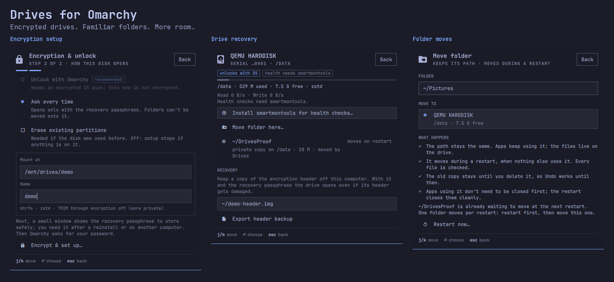
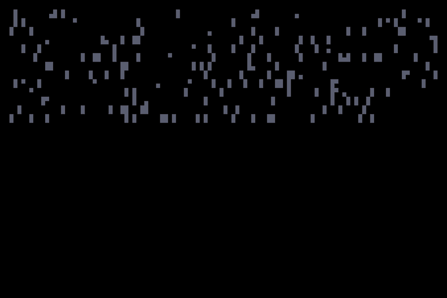

# Drives for Omarchy

A bar widget and panel for your disks on Omarchy Quattro.

- See every disk: how full it is, its health and live read/write speed.
- Set up a new data drive, encrypted, that unlocks together with your OS.
- Move a big folder (say `~/Videos`) onto that drive. Apps keep using
  `~/Videos` as before; the files just live on the other drive.
- Find out what fills your OS disk, and move it from there.



*Screenshots use synthetic VM data. Colours follow your Omarchy theme.*



*The restart screen, recorded from the real screen code during a copy and
check. Copy progress is measured; speed and time remaining are estimates.*

## Install

One line:

```sh
omarchy plugin add https://github.com/Zeus-Deus/drives-omarchy-plugin.git --enable --yes && sudo bash ~/.config/omarchy/plugins/io.github.zeus-deus.drives/helper/install.sh
```

The first part adds **Drives** to your bar. The second explicitly installs
the system helper needed to set up drives and move folders. Installing from
the store alone does not install that helper; without it, disk viewing and
folder-size scans still work.

Runtime dependencies are Python with PyGObject/Gio and GTK4, UDisks2,
cryptsetup, rsync, btrfs-progs, ACL tools, util-linux, systemd, D-Bus,
polkit and `wl-clipboard` (`wl-paste`, for bounded clipboard paste). These
are provided by the tested Omarchy installation. Disk health
also needs optional `smartmontools`; the panel offers to install it through
Omarchy's own terminal.

Update:

```sh
omarchy plugin update io.github.zeus-deus.drives && sudo bash ~/.config/omarchy/plugins/io.github.zeus-deus.drives/helper/install.sh && omarchy-restart-shell
```

## Uninstall

One line:

```sh
sudo bash ~/.config/omarchy/plugins/io.github.zeus-deus.drives/helper/uninstall.sh && omarchy plugin remove io.github.zeus-deus.drives --yes
```

Your drives and moved folders keep working without the plugin. Drive keys,
header backups, journals, crypttab/fstab entries and automount-hiding rules
are retained for this reason. Uninstall refuses while maintenance is pending
or active; it is not a data or encryption-key purge.

## Moving a folder

1. Open **Drives**, choose **What's using it** on your OS disk, and pick a
   folder (or type one).
2. Review the move and enter your password. Nothing moves yet.
3. Restart. This restart takes a little longer: the folder is copied, every
   file is checked, then your desktop comes back. The screen shows the Omarchy
   logo with live progress: how much is copied, the speed and the time left.
   Don't turn the computer off during it.

Want to see that screen first? From a text console (Ctrl+Alt+F3, log in),
run `python3 -m helper.bootscreen --demo` inside
`/usr/lib/drives-helper`. It copies Omarchy's own files to a temporary
folder, checks them and deletes the copy; nothing is moved.

You don't need to close apps first; the restart closes them cleanly. After
an interrupted move, Drives restores the original when it can prove the
storage and copies are intact. If that proof is unavailable, it keeps the
copies and blocks normal startup rather than guessing. Administrator recovery
may be needed; see [Recovery](docs/DESIGN.md#interruptions-and-recovery).

## Getting the space back

After a move, **the old copy stays on your OS disk** as a safety net. It is
not deleted automatically, so the space is not freed yet.

When you're happy with the move:

1. Open **Drives** and click the folder under **Moved folders**.
2. Choose **Delete old copy** and confirm.

The panel shows how far the deletion is. Big folders take a few minutes.
After a restart, Drives retries a deletion you already confirmed once the
drive and active folder are available. If a safety check fails, the remaining
old copy is kept and the panel reports the error.

On Btrfs, snapshots can keep the deleted data for a while, so the free space
may show up a bit later.

## Changed your mind?

Click the moved folder:

- **Undo move** puts the original back exactly as it was. Only while the old
  copy still exists, and only if nothing changed since the move.
- **Move back** copies your latest files back to the OS disk during a
  restart, including changes since the move. Works even after you deleted
  the old copy.

## Good to know

- Every new storage change requires administrator authorization. Drives only
  resumes a deletion you already confirmed without asking again.
- New drives get a recovery passphrase, for a reinstall or another computer.
  It is typed in a separate small window, never in the panel.
- A drive that unlocks with the OS keeps its key on the OS disk, so it is
  only as safe as your OS disk encryption. Drives refuses this on an
  unencrypted OS disk.
- Manual-unlock mode keeps no OS unlock key. Use the separate recovery
  window to unlock that drive again after a restart.
- Export the drive's header backup (on the drive's page) and keep it off this
  computer.
- Drives and binds you set up by hand are recognized read-only. If you choose
  such a drive for a move, its top folder (like `/data`) is made system-owned
  only with your explicit consent; everything inside stays yours.
- It won't move your whole home folder, folders outside your home, or a
  folder with another drive mounted inside it. Files hard-linked elsewhere
  need explicit consent to become separate copies. The other names keep
  working, but their data can still occupy space on the original disk.

## Security

Disk changes use fixed helper operations and explicit polkit administrator
authorization. `sudo` is used only for the helper install/removal commands
above; optional `smartmontools` installation runs in Omarchy's terminal.
Drives makes no network requests of its own and has no telemetry. Dependency
installation and plugin updates use their respective package/Git sources.
See [the design](docs/DESIGN.md) for the privilege and recovery boundaries,
and [verification](docs/VERIFICATION.md) for the tested cases and remaining limits.

More detail: [docs/DESIGN.md](docs/DESIGN.md). For contributors:
[docs/DEVELOPMENT.md](docs/DEVELOPMENT.md).

License: MIT.
